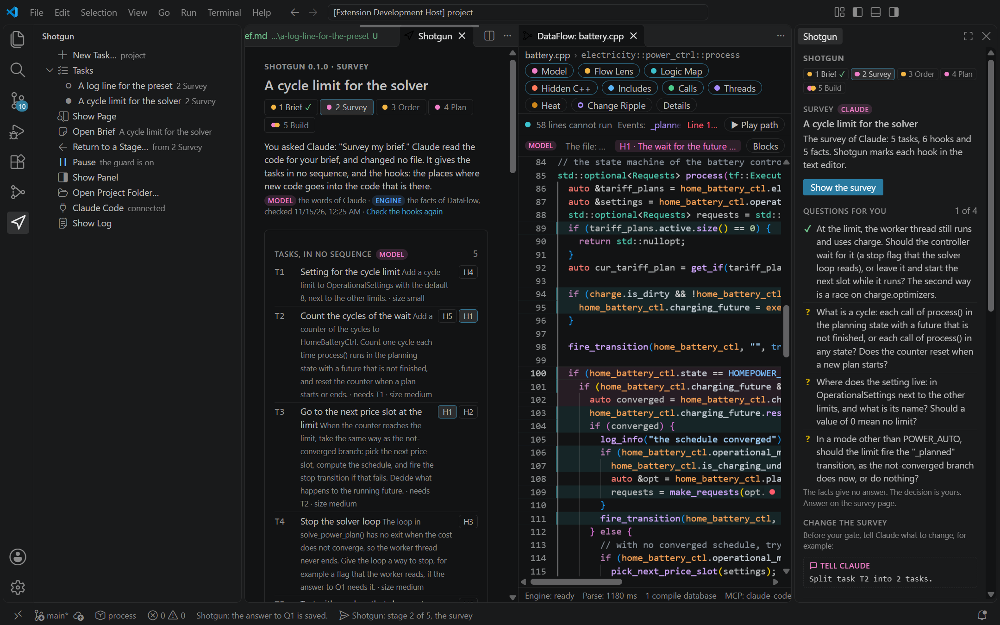
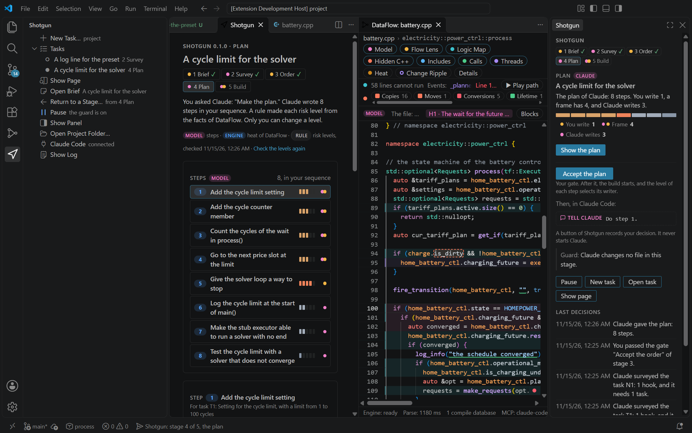
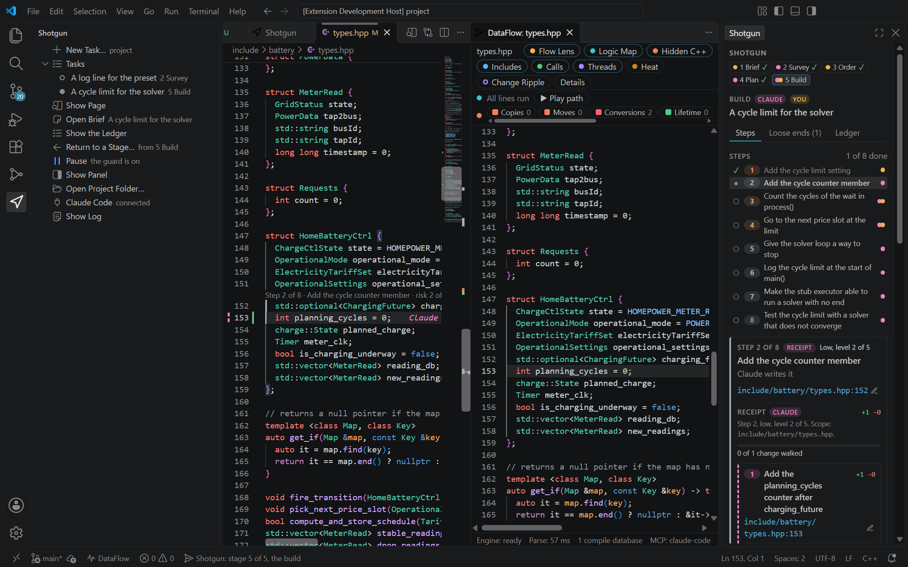
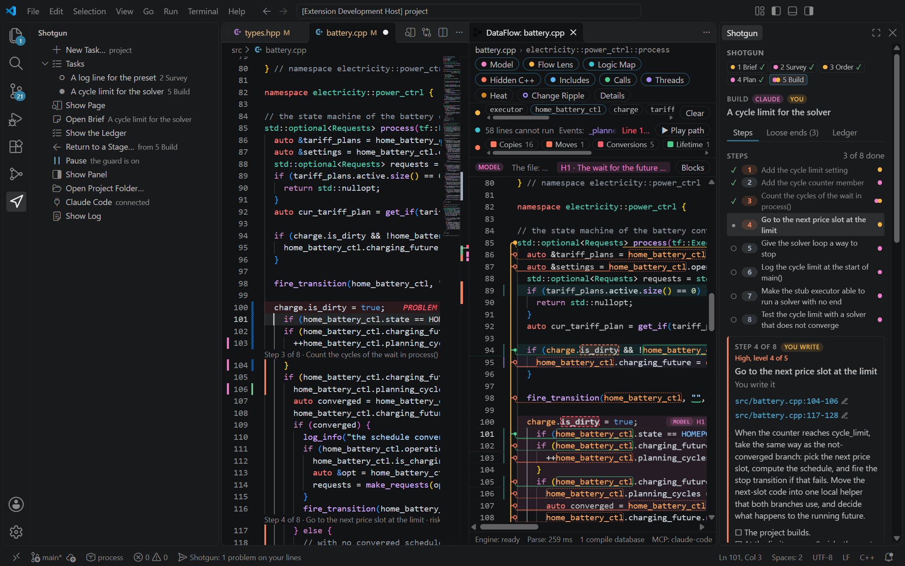
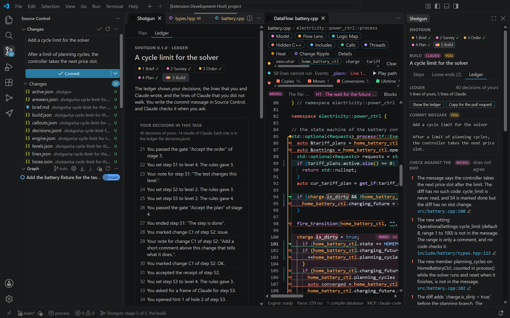

# Shotgun

Shotgun is an extension for Visual Studio Code. It is for pair programming with Claude Code on C and C++ code. You make the decisions, and you keep the ownership of the code. Claude does the work that you give it, and DataFlow gives the facts of the code.

## Overview

A task goes through 6 stages:

| Stage | Writer | Work |
| --- | --- | --- |
| 1 Brief | You | You write the brief: the goal, the facts, the specs, the limits and the condition of done. Each part is optional. |
| 2 Survey | Claude | Claude reads the code. It gives the facts, the tasks and the hooks: the places where new code goes into the code that is there. |
| 3 Order | You | You put the tasks in sequence. You can rewrite a task, add a task, or keep a task for later. |
| 4 Plan | Claude | Claude makes the steps of the plan. Shotgun gives each step a risk level from the facts of DataFlow. |
| 5 Build | You and Claude | The risk level of a step selects its writer. You write the steps with the most risk. |
| 6 Review | Claude, then you | A new session of Claude Code reviews the whole diff with your effort and focus. You work through the issues. |

A gate ends each stage, and only you pass a gate. A button of Shotgun records a decision of yours. It never starts Claude: you type each request in Claude Code. You can return the task to an earlier stage at any time.

The plan names the open decisions of each step: the choices that your brief and your answers do not settle. A step with no open decision gets at most level 2, so Claude writes it. On the plan page, you can answer a decision in words, or add a decision of yours. In the build, the risk level of a step selects its writer:

| Level | Writer |
| --- | --- |
| 1 and 2 | Claude does the step as an errand. You walk its receipt, and put a mark on each change. The receipt shows the choice of Claude for each open decision. |
| 3 | Claude writes a frame with a hole for each open decision. You fill the holes, with 4 hints for each hole. |
| 4 | You write the step. You can ask for a frame. |
| 5 | You write the step, also with no open decision. Claude changes no file, but it answers your questions. |

The guard of Shotgun stops each file change of Claude in the stages 1 to 4 and in stage 6. In the build and in the steps of the issues, it lets Claude change only the files of its open step. While you write, Shotgun shows the new facts of DataFlow on your lines as callouts, for example a race. The ledger keeps your decisions and the writer of each changed line.

In stage 6, you select the effort and the focus of the review, and paste its prompt into a new session of Claude Code. The new session did not write the code, so it reviews with a fresh view. It checks each candidate in a verify pass, and gives each issue with a failure scenario and the evidence of DataFlow. Shotgun shows the confirmed new issues in the list of steps, and the other issues in a second list. Each issue of the list of steps is a step of yours, as in the build. You close an issue that is not a problem with a reason, and the next review gets it. After your fixes, the next round checks them.

Shotgun needs DataFlow 0.6.2 or later, VS Code 1.143 or later, and Claude Code 2.1.323 or later. DataFlow works only on Windows 64-bit, so Shotgun works only there too.

## Quickstart

1. Install DataFlow 0.6.2 or later. [Install DataFlow](https://github.com/KnurrliDev/DataFlow/blob/master/docs/install.md) tells how.
2. Download the VSIX file of the [latest release](https://github.com/KnurrliDev/Shotgun/releases/latest) of Shotgun. In VS Code, install it with **Extensions: Install from VSIX…**.
3. Open the folder of a C or C++ project with a compile database.
4. Open a C++ file. DataFlow asks if it can connect to Claude Code. Click **Connect**. If DataFlow does not ask, run **DataFlow: Connect to Claude Code**.
5. Click the icon of Shotgun in the activity bar. In the sidebar of Shotgun, click **Claude Code** to connect Shotgun to Claude Code.
6. Click **New Task…**, and give the title of the task. Shotgun opens `brief.md`.
7. Start a new session of Claude Code in the folder of the project.
8. Write your brief in `brief.md`. Each part is optional. Then click **The brief is ready** in the panel of Shotgun.
9. Tell Claude "Survey my brief.".

After each gate, the panel of Shotgun shows the next work and the request for Claude Code. [Use Shotgun](docs/usage.md) tells each stage.

## Showcase

The screenshots show a task in the test project of DataFlow: the controller of a home battery.

### The survey

Claude reads the code for your brief, and gives the tasks, the hooks, the facts and its questions. Shotgun gets the facts of DataFlow for each hook: the function, the threads, the locks and the heat. A click on a hook shows its lines in the side view of DataFlow. The screenshot at the top shows the survey. [The survey](docs/usage.md#the-survey)

### The plan

Claude makes the steps of the plan in your sequence. Shotgun gives each step a risk level from the facts of DataFlow, and only you change a level. [The plan and the risk levels](docs/usage.md#the-plan-and-the-risk-levels)

### The receipt

Claude does a step of level 1 or 2 as an errand, and gives a receipt. The panel shows each change with a check for you. The text editor marks each line of Claude in the gutter. [The build](docs/usage.md#the-build)

### Callouts

While you write a step, Shotgun shows the new facts of DataFlow on your lines. Here, a new line of the user makes a race on `charge.is_dirty`. Claude explains a callout when you ask. [Callouts](docs/usage.md#callouts)

### The ledger

The ledger keeps your decisions and the writer of each changed line. Claude checks your commit message against the diff, and you commit. [The ledger and the commit message](docs/usage.md#the-ledger-and-the-commit-message)

## Documents

- [Install Shotgun](docs/install.md): the VSIX package, the connection to Claude Code, and the build from the source code
- [Use Shotgun](docs/usage.md): the 6 stages, the sidebar, the panel, the page, the commands and the settings
- [The tools and the skills](docs/tools.md): the plugin of Shotgun for Claude Code, its hooks and skills, and each tool with its parameters
- [Develop Shotgun](docs/development.md): the files, the tests and the releases
- [Changelog](CHANGELOG.md): the changes of each release

## License

Shotgun has the MIT License. See [LICENSE](LICENSE).
